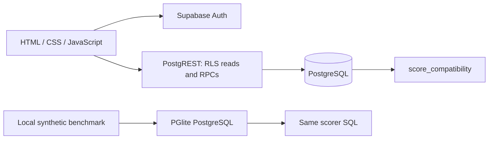

# FYP2 implementation and testing material

Baseline reviewed: FYP1 report, 104 PDF pages. Page references here are physical PDF pages, not printed page numbers.
This document supersedes earlier unsupported implementation/verification claims.

## Requirements and architecture

FYP1 pages 16–18 establish four objectives and a student/graduate decision-support scope. Appendix A pages
78–91 defines registration, login, profile management, recommendations, skill analysis, search, job management,
user management and logout. Account creation by administrators is included on pages 89–90. Applications appear
in Table 4.8 (pages 63-64) and the ERD (Figure A.2, page 93), but have no separate SRS use case. The minimal submission feature is a scope decision
requiring supervisor acknowledgement; employer recruitment, messaging and hiring decisions remain excluded.

FYP1 pages 48–49 proposed HTML/PHP/CSS/JavaScript, a dedicated web server and MySQL. The implementation uses
HTML/CSS/JavaScript, Supabase Auth/PostgREST and PostgreSQL. Auth provides identity/email workflows; database
constraints, RLS and guarded functions provide authorization and atomic writes. The compatibility calculation
runs in PostgreSQL. Browser code renders results and filters an already-ranked set. No Edge Functions are used.
The static Node server is a development file server, not the authentication backend. This technology substitution
should be approved by the supervisor; it preserves the relational entities and three-layer intent.

## Database and authorization

Nine public tables: users (1:1 with auth.users), profiles (1:1 users), skills, profile_skills, job_postings,
job_skills, recommendations, applications and skill_guidance. Junction tables enforce unique pairs. Applications
enforce unique (user,job). Interest/certification strings remain comma-separated text. The recommendations table
is retained for schema compatibility, but current recommendations are calculated on demand, not persisted as
an audit trail. Do not claim stored recommendation history. Skill guidance is an added lookup table.

The database role and account_status are authoritative. Editable user metadata is never used for authorization.
Signup provisions user/profile rows atomically and cannot assign Admin. Active access requires a confirmed email,
Active database account and an existing auth.sessions record matching the JWT session_id. Deactivation blocks
subsequent protected reads/writes even with a previously issued JWT. Own users-row reads remain permitted to
show account status. Admin role/status changes use a serialized RPC and prohibit self-demotion/deactivation.
The owner-selected first administrator was explicitly bootstrapped during deployment.

Anonymous roles have no application-table access. Authenticated users have RLS-scoped reads, restricted
application inserts and explicit RPC grants. Direct writes to roles, profiles, skills or jobs are denied.
Profile/job RPCs validate authorization and commit parent and skill changes in one transaction. Failed skill
writes roll back the parent update. Job removal is archival, preserving applications. Only Submitted applications
are accepted, for the caller and an active unexpired job. No employer receives a message from this action.

Five intentional authenticated SECURITY DEFINER entry points remain advisor warnings; checks are tested and
search paths are empty. This is not a claim that all security risks are eliminated. See setup notes for the
remaining leaked-password-protection setting and operational backup requirements.

## Authoritative scoring specification (engine v2)

`score = round(50*required + 20*preferred + 15*field + 15*interests, 2)`.
Weights are unchanged, heuristic and not empirically optimized. They are compatibility indicators, never hiring
probabilities. Technical and soft skills are both assigned required/preferred status by each job.

- Skills match exact numeric IDs from the shared catalogue. Name case does not enter scoring; no fuzzy matching,
  synonym inference, proficiency or certification recognition is performed. Database uniqueness prevents duplicates.
- Required coverage = matched required / all required; a job with no required skills receives 1 for this component
  (50 points), explicitly disclosed in the explanation. There is no weight redistribution.
- Preferred coverage = matched preferred / all preferred; zero preferred skills gives zero for this component.
- Field values are trimmed and lowercased. Exact nonempty field/industry equality matches. CS, Software Engineering
  and IT map to Information Technology, Software, Telecommunications and E-Commerce & Tech. Electrical Engineering
  and Electrical Power Engineering map to Engineering & Energy and Telecommunications. No substring shortcut is used.
- Interests are comma-separated, trimmed, lowercased, deduplicated, with empty tags removed. A tag matches as a
  literal substring of title plus description; the interest factor is the fraction of tags matched. Regex characters
  are literal. No stemming: “software development” does not automatically match “software developer”.
- Missing field/interests contribute zero; no user skills match zero listed skills. Empty profiles receive a completion
  prompt. Search still supports exploration with sparse data; this relaxes FYP1's recommendation precondition and
  should be acknowledged by the supervisor. A no-required-skills job can still receive 50 points for an empty profile.
- Only Active jobs with no deadline or a deadline on/after today's Asia/Kuala_Lumpur date are returned. Today is inclusive.
- Sort by two-decimal score descending, deadline ascending with null last, then numeric job ID ascending.
- Low scores remain visible for exploration and explanations show actual points. Empty result sets are a legitimate
  state. Backend errors show a retry message; there is no browser scoring fallback.

Dashboard, Search and Skill Analysis all use the recommendation RPC; the detail RPC delegates to that same list.
The evaluation script runs the same SQL in local PostgreSQL. Saved evaluation results are displayed in the browser;
there is no separate browser scoring implementation. Live pure-function parity is recorded separately when run.

## Profile completeness and guidance

Completeness: registered account 15; institution 7; programme 6; field 6; valid CGPA including zero 6; technical
skills 0/10/18/25 for 0/1/2/3+; soft skills 0/8/15 for 0/1/2+; interests 10; certifications 10. Total 100.
The form previews unsaved changes; dashboard computes from loaded saved data. RPC saves compute the stored value
server-side. Completeness describes supplied information, not verified competence or measured recommendation quality.

Guidance is a curated table plus a clearly generic fallback. Suggested durations are not measured learning outcomes.
A subject-matter reviewer should review this content; no study of its effectiveness has been performed.

## Testing and evaluation

See test-results.md for actual environments and evidence. Local SQL tests cover privilege escalation, cross-user
access, inactive/revoked sessions, atomic saves, deadlines, duplication, archival and scoring edge cases. Live SQL
uses transactional synthetic fixtures and explicit database-role/JWT-claim simulation. It is not a real Auth login.
Anonymous live REST requests are tested separately. The mock UI screenshot directory is separate from live-browser screenshots using dedicated synthetic accounts and real Auth tokens.

The synthetic fixture set contains 10 profiles and 12 jobs. Developer-authored labels are regression expectations,
not independent judgments. Mean P@5=0.58, Recall@5=0.935, macro F1@5=0.6949206 and full-ranking MAP=0.8967857 in the
recorded run. These figures do not establish general recommendation quality. Local SQL timings exclude the network
and rendering; they do not establish FYP1's 3-second recommendation target.

Actual participant SUS and independently judged relevance results are pending. The revised planning target is
15 usability participants (0 collected), replacing inconsistent 30 versus 10–15 targets. FYP1's 50 survey responses
and four elicitation interviews are background research, not FYP2 usability participants.

## Limitations and supervisor decisions

Acknowledge: technology substitution, minimal application submission, archival instead of destructive job deletion,
exploratory scores for sparse profiles, draft profile saves with optional academic fields, and the planned study size.
Approval has not been fabricated. Password reset and administrator-created account email delivery require live mailbox
checks. Core authenticated browser journeys and 20 sequential recommendation timings passed (see test-results.md). Concurrency/load tests, cross-browser Safari/Firefox/Chrome checks,
backup restoration and operational availability remain pending. No public deployment or real participant study was
performed by the agent. New test results must identify the test, environment, observed result and evidence location.
